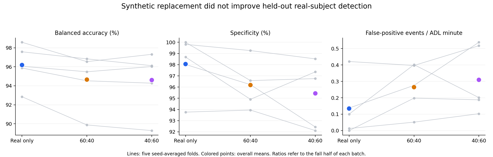

# A10–A14 CoM Transformer augmentation: reviewed results

Reviewed November 27, 2026. Source: `Fifteen_Subject_A10_A14_CoM_Transformer_Physics_Augmentation_Ratios_5_Seeds_Results.zip`.

## Decision

Keep the real-only detector as the reference model. Neither tested synthetic replacement ratio improved overall performance. The next priority is an exposure-preserving, low-weight synthetic experiment, followed by a generator-source control if downstream benefit emerges. Do not select a new architecture or add yaw merely to rescue these results.

## Completed experiment and verified results

All 75 runs completed: three conditions × five folds × five seeds (11, 22, 33, 44, 55). The detector consumes theta and x only; A14 yaw is not a detector input. Windows have 64 frames at 30 Hz. Each batch has 30 real ADL windows and 30 fall windows. The fall positions are 30/0, 18/12, or 12/18 real/synthetic. Thus 40% and 60% describe synthetic shares of fall examples, not shares of the entire batch.

| Metric | Real only | Real 60 : synthetic 40 | Real 40 : synthetic 60 |
|:--|--:|--:|--:|
| Balanced accuracy | 96.19 ± 2.45 | 94.65 ± 2.94 | 94.60 ± 3.29 |
| Sensitivity | 94.32 ± 3.64 | 93.12 ± 5.57 | 93.77 ± 4.96 |
| Specificity | 98.05 ± 2.46 | 96.18 ± 3.18 | 95.44 ± 3.81 |
| F1 | 95.45 ± 3.18 | 93.28 ± 3.61 | 93.08 ± 4.30 |
| AUROC | 98.70 ± 1.27 | 98.55 ± 1.68 | 98.29 ± 2.02 |
| AUPRC | 98.75 ± 1.13 | 97.97 ± 2.43 | 97.51 ± 3.16 |
| False-positive events / ADL minute | 0.134 ± 0.166 | 0.265 ± 0.226 | 0.309 ± 0.259 |

Values are means ± sample SD across 25 fold–seed runs. All metrics except false-positive rate are expressed in percent (including F1 and AUC). SD describes run variability, not an independent-sample confidence interval. Fold training sets overlap and seeds reuse subjects.

Compared with real only, 60:40 reduced balanced accuracy by 1.54 percentage points and 40:60 by 1.59 points. False-positive events increased from 0.134/min to 0.265/min (1.97×) and 0.309/min (2.30×). Both mixtures reduced balanced accuracy and F1 in every seed-averaged fold.

## Activity results

| Activity | Real only | 60:40 | 40:60 |
|:--|--:|--:|--:|
| A10 | 90.87% | 88.97% | 91.59% |
| A11 | 96.00% | 89.44% | 91.82% |
| A12 | 91.42% | 93.02% | 92.90% |
| A13 | 94.54% | 96.88% | 95.64% |
| A14 | 99.20% | 97.48% | 97.02% |

A12 and A13 have modest mean sensitivity gains with augmentation. A11 declines by 6.56 points for 60:40 and 4.18 points for 40:60. A14 declines from 99.20% to 97.48% and 97.02%. These are exploratory activity patterns; they do not justify claiming an overall benefit or selecting activities using these same test outcomes without subsequent validation.

## Statistical interpretation

The supplied two-sided Wilcoxon tests use five seed-averaged fold pairs, with Holm adjustment across the three condition comparisons within each metric. For balanced accuracy, both augmented-vs-real-only comparisons have raw p=0.0625 and adjusted p=0.1875. With five nonzero pairs, 0.0625 is the smallest attainable two-sided exact Wilcoxon p-value. Therefore consistent losses across all five folds do not reach p<0.05 in this design. No reported adjusted comparison is significant at 0.05. This does not demonstrate equivalence, and the experiment does not establish that synthetic augmentation can never help. The appropriate conclusion is: **the tested mixtures did not improve performance and consistently worsened the primary endpoint in this evaluation**.

## Verification

The review recomputed trial balanced accuracy, sensitivity, specificity, F1, AUROC, AUPRC, and confusion counts from the saved prediction CSVs. It also checked window-to-trial max aggregation, predicted labels, validation-only threshold selection, false-positive event counting, epoch histories, matching split membership, real-only evaluation sources, matching initialization hashes, and identical scalers for paired runs.

All 801 recorded checks passed. There are 867 unique test trials (322 falls and 545 ADL) across the five test folds, reused across conditions and seeds. S31 and S59 are grouped as one subject unit; subject review tables combine them. Per-run metrics are not 75 independent subject experiments.

This audit verifies saved predictions and run metadata, not the entire raw-data lineage. The result archive does not contain the raw prepared training arrays or detector model checkpoints, so independent model inference and complete synthetic-provenance checks were not rerun. Training source routing should remain checked against generation manifests in the next experiment.

## Diagnostics and explanation

1. **Real-data exposure was reduced.** At 32 updates per epoch, real-fall draws per epoch were 960, 576, and 384. Mean best epochs were 21.92, 17.08, and 18.28. Mean real-fall draws through the selected checkpoint were 21,043, 9,838, and 7,020 respectively (draws include repeated sampling). Synthetic replacement plus earlier stopping therefore reduced real-fall exposure substantially. This is a plausible explanation, not an isolated causal finding.
2. **The score operating point shifted.** Mean validation-selected thresholds were 0.566, 0.890, and 0.874. As a diagnostic only, a fixed 0.5 threshold gives mean test balanced accuracy of 96.35%, 91.66%, and 90.96%. Validation threshold selection already mitigated the augmented models' false positives. A fixed threshold is not being substituted for the original protocol or selected using test data.
3. **Ranking changed less than thresholded performance.** AUROC changed by −0.15 and −0.41 percentage points, whereas specificity changed by −1.87 and −2.62 points. Score shift/calibration and reduced real exposure deserve investigation; these results alone do not establish a calibration mechanism.
4. **ADL errors are concentrated.** Across five seed evaluations of the held-out trials, A02 false-positive trial decisions rose from 16 to 46 and 62; A08 from 26 to 30 and 39. These are repeated trial decisions across seeds, not unique subjects or continuous monitoring events. Activity names were not inferred from their IDs. Review these ADL types using training/validation data before changing the sampler.
5. **Generation quality and detector utility are different endpoints.** Passing the physics/continuity GATE did not guarantee beneficial augmentation. This experiment includes only direct-physics synthetic generators; it does not compare physics versus no-physics generation.

## Recommended next experiments, in order

### 1. Preserve real-data exposure and add a small synthetic loss

Retain the real-only architecture, theta/x features, grouped folds, real-only normalization, and validation/test protocol. Every update should retain the same 30 real ADL + 30 real fall examples as the baseline; draw synthetic examples separately. Use the same real sample order, initialization, optimizer-update budget, and checkpoint rule in all arms. Decouple real sampling RNG from synthetic sampling RNG. Log exposure through each checkpoint. For the causal comparison, use a fixed training budget; report both fixed-endpoint and identically selected validation checkpoints so early stopping does not silently reintroduce an exposure difference.

Use three prespecified weights alpha = 0, 0.10, 0.25 with

`L = 0.5 * L_ADL + 0.5 * (L_real_fall + alpha * L_synthetic_fall) / (1 + alpha)`.

Each component is its own mean BCE loss. This keeps total ADL/fall loss weight at 50:50 while preserving the baseline real examples. Alpha is an auxiliary loss weight, not the original batch ratio; its synthetic share within fall loss is 0%, 9.09%, or 20%. Normalize losses explicitly and log additional forward-pass cost. Include a real-replay auxiliary arm if making a strict claim about synthetic information beyond additional computation/gradient averaging.

Pilot: three arms × five folds × two paired seeds = 30 runs. This is a development screen, using validation outcomes to decide continuation. A full five-seed evaluation is 75 runs. Avoid repeated test-guided tuning; these previously inspected test folds are now development evidence. For a confirmatory claim, use new untouched subjects or a fully nested selection protocol with transparent disclosure of prior test reuse.

Success criterion: validation improvement in the primary balanced-accuracy endpoint without increased false-positive rate or material specificity loss, with prespecified priorities. Keep the real-only baseline if this does not occur. Do not run another high-dose replacement sweep first.

### 2. Establish whether physics adds value beyond ordinary augmentation

Once a useful low-dose protocol is identified, compare matched real-only, real-replay/simple augmentation, no-physics generator, and physics generator arms. Match source trials, subject splits, number of synthetic samples, family weighting, real exposure, and training budget. Use common non-physics validity checks for all generated samples; assess physics GATE filtering separately so generator physics and filtering are not conflated. Any generator used for an outer test fold must exclude that fold's test subjects; any generator whose hyperparameters were selected using the detector's validation subjects also compromises detector validation independence and must be handled inside the nested training/selection split.

This addresses the thesis claim about the value of physics. The current ratio comparison cannot answer it.

### 3. Test the low-real-data regime if full-data augmentation still fails

Prespecify 25%, 50%, and 100% real-fall training budgets, matched within subject/activity, with identical retained real subsets across arms. Compare real-only against the best validation-chosen low-dose augmentation. A strict data-efficiency claim requires refitting the generator using only the permitted training subset; using a generator trained on withheld real falls introduces extra information. Keep real ADL exposure and real held-out evaluation fixed. Start with one reduced-data pilot before launching the entire grid.

### 4. Evaluate deployable inputs and time windows before claiming online detection

The current detector is evaluated on prepared fall clips with a final window aligned to apparent contact, while ADL trial scores are max-pooled across windows. A14 planar direction uses onset-to-contact motion; A10–A13 axes use activity labels. These results measure the specified offline task, not an activity-agnostic online detector. A future deployment study should use past-only common coordinates and sliding windows for every activity, retain full ADL sequences, and measure detection latency and false alarms over time. Do not mix this representation change into the first exposure experiment.

Yaw is lower priority. A future yaw study must supply comparable yaw information for all real/synthetic activities and control missingness; adding yaw only for A14 can introduce a source/activity cue.

## Files and reproducibility

`review/recompute_review.py` regenerates the audit and CSV tables from the archived predictions using Python, NumPy, pandas, and scikit-learn. `review/paired_fold_results.png` plots seed-averaged fold results. Original result CSVs and per-run artifacts remain unchanged; this reviewed package updates README/FINDINGS and adds the review. `review/audit_summary.json` records the audit scope and outcome. No training was rerun.
