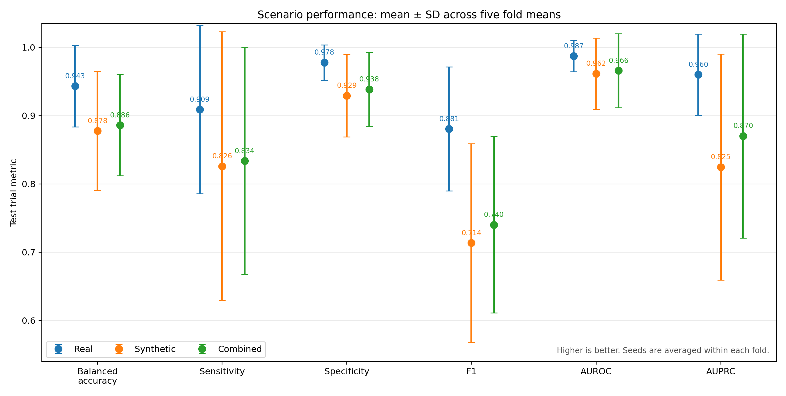
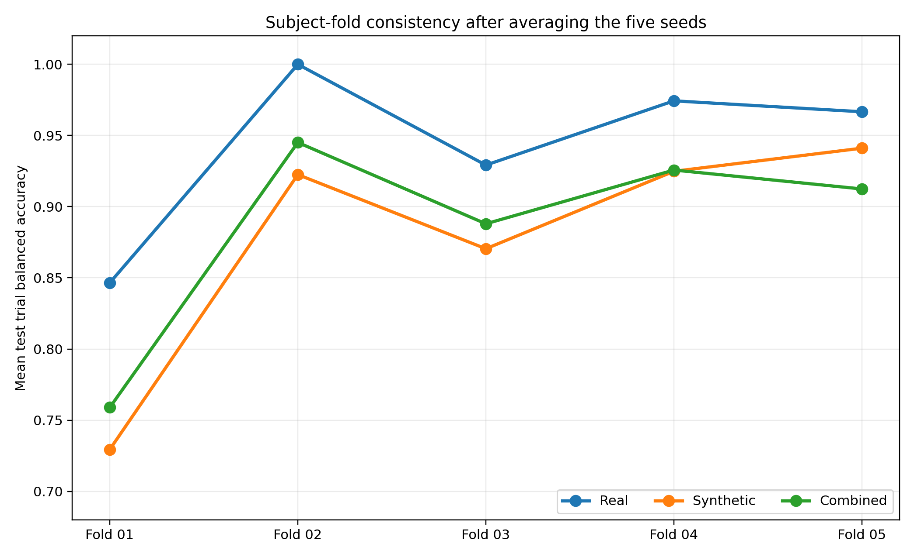
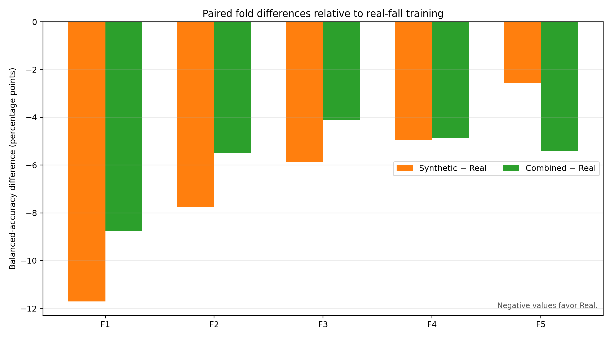
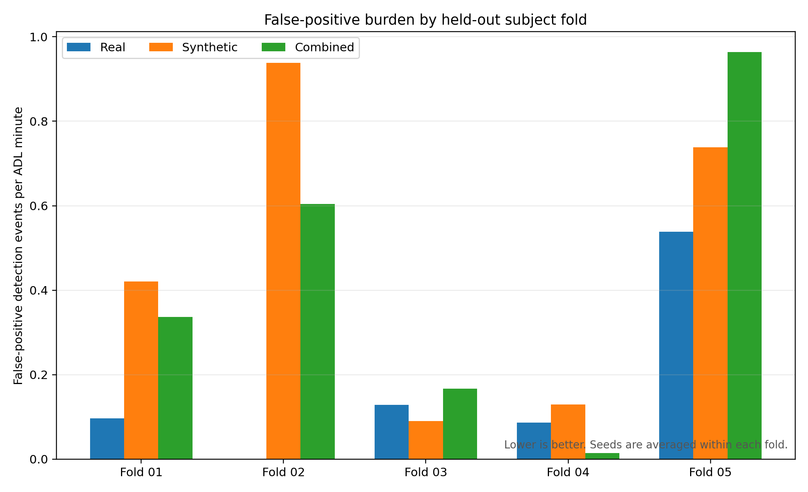

# CoM Transformer fall-detector findings

## Executive conclusion

The full experiment completed successfully: **75 MPS training runs** covering three scenarios, five subject-disjoint folds, and five random seeds.

Using test-trial balanced accuracy as the primary metric, the descriptive winner is:

> **Real A11 falls + real ADL**

It achieved the best mean value for every reported performance metric and the lowest mean false-positive event rate. Real-fall training also produced the highest fold-averaged balanced accuracy in all five held-out subject folds.

This is a strong and consistent descriptive result, but it is **not statistically significant after Holm correction**. The five fold means are the independent paired units used by the Wilcoxon analysis. With only five pairs, the smallest attainable exact two-sided Wilcoxon p-value is 0.0625; the primary balanced-accuracy comparisons have Holm-adjusted p = 0.1875.

## Completion and evaluation protocol

- Completed runs: 75/75.
- Device: Apple MPS for all 75 runs.
- Scenarios: 3.
- Subject-disjoint folds: 5.
- Random seeds per fold: 5.
- Matched fold/seed settings per scenario: 25.
- Validation and test data: real A11 falls and real ADLs only.
- Synthetic falls: training only.
- Checkpoint and threshold selection: validation subjects only.
- Approximate summed training/evaluation time recorded by the runs: 27.6 minutes.

## Main results

The table reports the descriptive mean ± standard deviation across the 25 fold/seed runs. The paired statistical analysis separately averages seeds inside each fold before testing.

| Test-trial metric | Real falls + ADL | Synthetic falls + ADL | Real + synthetic falls + ADL | Winner |
|---|---:|---:|---:|---|
| Balanced accuracy | **0.943 ± 0.060** | 0.878 ± 0.093 | 0.886 ± 0.084 | Real |
| Sensitivity | **0.909 ± 0.121** | 0.826 ± 0.198 | 0.834 ± 0.182 | Real |
| Specificity | **0.978 ± 0.036** | 0.929 ± 0.071 | 0.938 ± 0.072 | Real |
| F1 | **0.881 ± 0.107** | 0.714 ± 0.167 | 0.740 ± 0.157 | Real |
| AUROC | **0.987 ± 0.022** | 0.962 ± 0.050 | 0.966 ± 0.051 | Real |
| AUPRC | **0.960 ± 0.058** | 0.825 ± 0.179 | 0.870 ± 0.155 | Real |
| False-positive events/ADL minute ↓ | **0.170 ± 0.316** | 0.463 ± 0.467 | 0.417 ± 0.507 | Real |

Relative to synthetic-only fall training, real-fall training improved mean balanced accuracy by **6.57 percentage points**, F1 by **16.71 points**, and AUPRC by **13.53 points**. Its mean false-positive event rate was **63.3% lower**.

Relative to combined training, real-fall training improved mean balanced accuracy by **5.73 percentage points**, F1 by **14.04 points**, and AUPRC by **8.98 points**. Its mean false-positive event rate was **59.3% lower**.

## Fold consistency

Fold-averaged balanced accuracy was:

| Test fold | Real | Synthetic | Combined | Best |
|---|---:|---:|---:|---|
| Fold 01 | **0.847** | 0.729 | 0.759 | Real |
| Fold 02 | **1.000** | 0.923 | 0.945 | Real |
| Fold 03 | **0.929** | 0.870 | 0.888 | Real |
| Fold 04 | **0.974** | 0.925 | 0.926 | Real |
| Fold 05 | **0.967** | 0.941 | 0.912 | Real |

Real-fall training beat synthetic-only and combined training in all five fold means. Across the 25 matched fold/seed runs, real training had higher balanced accuracy than synthetic training in 20 runs, with 3 ties, and higher balanced accuracy than combined training in 22 runs, with 1 tie.

Fold 01 was the hardest held-out subject group for every scenario. Fold 02 was easiest and reached perfect mean balanced accuracy for real-fall training.

## What the synthetic results mean

The synthetic-only scenario performed well on unseen real subjects:

- balanced accuracy: 0.878;
- AUROC: 0.962;
- AUPRC: 0.825.

Therefore, the approved synthetic trajectories contain useful real-fall signal and transfer substantially better than chance to real test data. They did not, however, replace real falls without a performance reduction.

Combined training slightly improved on synthetic-only training on average: +0.84 percentage points in balanced accuracy, +2.67 points in F1, and +4.55 points in AUPRC. It still did not improve over real-only training.

One plausible explanation is the mixture policy. Mini-batches balance the fall and ADL classes, but the fall half is not separately balanced between real and synthetic sources. The complete prepared pool contains 70 real and 226 synthetic falls, so approximately 76% of available positive trajectories are synthetic. Consequently, the combined condition is synthetic-heavy. This is an inference from the sampling design, not a proven cause of the result.

## Statistical interpretation

For each metric, the analysis:

1. averages the five seeds inside each fold;
2. performs three paired Wilcoxon comparisons across the five fold means;
3. applies Holm correction across those three comparisons.

No Holm-adjusted p-value is below 0.05. For balanced accuracy:

| Paired comparison | Mean difference | Unadjusted p | Holm-adjusted p |
|---|---:|---:|---:|
| Synthetic − Real | −0.0657 | 0.0625 | 0.1875 |
| Combined − Real | −0.0573 | 0.0625 | 0.1875 |
| Combined − Synthetic | +0.0084 | 0.4375 | 0.4375 |

The appropriate conclusion is:

> Real-fall training is the consistent descriptive winner in this experiment, but the study does not establish a statistically significant difference at Holm-adjusted α = 0.05.

The absence of significance should not be interpreted as evidence that the scenarios are equivalent. With only five fold-level pairs, the exact Wilcoxon test has very low resolution.

## How to read `scenario_metric_boxplots.png`

Each metric panel contains 25 results per scenario: five folds × five seeds.

- Orange line inside the box: median.
- Bottom and top of the box: 25th and 75th percentiles.
- Box height: interquartile range, showing the middle 50% of results.
- Whiskers: non-outlying range under the standard 1.5 × IQR rule.
- Open circles: runs beyond the whiskers.
- Green triangle: arithmetic mean.

The Real boxes are generally higher and tighter. The largest differences appear in F1 and AUPRC. The synthetic and combined conditions show wider variability, especially for sensitivity, F1, and AUPRC. AUROC remains high for all scenarios, meaning their probability rankings are generally strong even when the validation-selected operating threshold produces weaker sensitivity or precision.

The boxplots mix fold difficulty and random-seed variability into one distribution and do not show that the same fold/seed settings are paired across scenarios. Therefore, they are useful for distribution shape, but the new fold-level figures are better for interpreting the scientific comparison.

## Enhanced comparison figures

- `scenario_performance_overview.png`: exact scenario means with variability across the five fold means.
- `foldwise_balanced_accuracy.png`: shows the same held-out fold under all three scenarios and demonstrates that Real ranks first in every fold.
- `paired_balanced_accuracy_differences.png`: directly plots Synthetic − Real and Combined − Real for each fold; all bars are negative and therefore favor Real.
- `false_positive_events_by_fold.png`: compares operational false-positive burden; lower is better.
- `scenario_metric_boxplots.png`: retains the original 25-run distribution view.

## Recommendation

Use **Real A11 falls + real ADL** as the current best-performing detector configuration and thesis baseline.

Do not discard the synthetic generator. The synthetic-only result demonstrates meaningful cross-domain transfer, but the current augmentation mixture does not improve the real-only detector. Before concluding that synthetic augmentation cannot help, run one controlled follow-up study in which the fall half of each training batch is explicitly source-balanced. Recommended validation-selected ratios are:

- real:synthetic = 1:0, the existing real baseline;
- real:synthetic = 3:1;
- real:synthetic = 1:1;
- real:synthetic = 1:3, close to the current synthetic-heavy pool.

Keep the architecture, folds, seeds, real validation/test sets, and optimizer-step budget unchanged. Select the mixture ratio using validation-subject performance only, then evaluate the chosen policy once on the held-out real test subjects.

