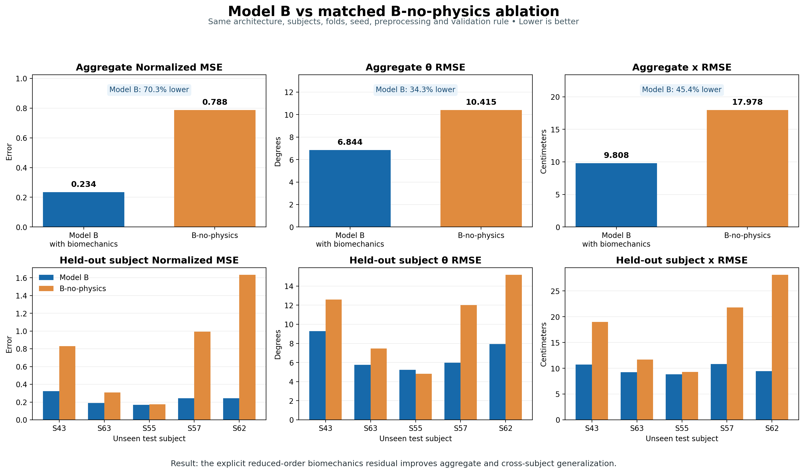

# Experiment 5 findings — Model B-no-physics

## Executive conclusion

The matched ablation supports the value of the explicit reduced-order
biomechanics residual. Model B, which includes the residual, outperformed
Model B-no-physics on all seven subject-averaged test metrics.

The primary results were:

| Metric | Model B | B-no-physics | Model B error reduction |
|:---|---:|---:|---:|
| Normalized MSE | **0.234** | 0.788 | **70.34%** |
| Theta RMSE | **6.844 deg** | 10.415 deg | **34.29%** |
| Theta MAE | **5.162 deg** | 8.269 deg | **37.57%** |
| x RMSE | **9.808 cm** | 17.978 cm | **45.45%** |
| x MAE | **7.403 cm** | 14.302 cm | **48.24%** |
| Theta Wasserstein-1 | **3.786 deg** | 5.852 deg | **35.30%** |
| x Wasserstein-1 | **5.044 cm** | 11.005 cm | **54.17%** |

All metrics are errors, so lower values are better.



## Why this is a controlled comparison

Model B and B-no-physics use the same:

- five subjects and five subject-held-out folds;
- 20 real held-out test trials and 2,838 forecast samples;
- real A11 preprocessing and validity masks;
- four-window context encoder;
- positive Softplus four-coordinate controller head;
- DeepONet branch and Fourier-time trunk;
- hard initial-state trajectory form;
- demographics, initial state, fixed auxiliaries, and query-time inputs;
- initialization seed, data-order seed, optimizer, learning rate, batch size,
  epoch budget, gradient clipping, and early stopping;
- real validation-subject checkpoint selection; and
- real unseen-subject evaluation and aggregation.

The optimization objective is the controlled difference:

```text
Model B:            L = L_real_forecast + 0.01 * L_biomechanics
Model B-no-physics: L = L_real_forecast
```

Therefore, unlike the earlier comparison between Model A and Model B, this
experiment isolates the contribution of the explicit biomechanics residual
while holding the controller-head parameterization fixed.

## Held-out-subject results

| Test subject | B norm. MSE | B0 norm. MSE | B theta RMSE | B0 theta RMSE | B x RMSE | B0 x RMSE |
|:---|---:|---:|---:|---:|---:|---:|
| S43 | **0.322** | 0.830 | **9.292 deg** | 12.601 deg | **10.721 cm** | 18.979 cm |
| S63 | **0.190** | 0.309 | **5.769 deg** | 7.469 deg | **9.236 cm** | 11.706 cm |
| S55 | **0.169** | 0.175 | 5.234 deg | **4.826 deg** | **8.850 cm** | 9.292 cm |
| S57 | **0.244** | 0.992 | **5.980 deg** | 12.011 deg | **10.805 cm** | 21.812 cm |
| S62 | **0.243** | 1.632 | **7.945 deg** | 15.170 deg | **9.426 cm** | 28.101 cm |

Model B achieved lower normalized MSE and x RMSE for all five test subjects.
It achieved lower theta RMSE for four subjects; B-no-physics was slightly
better only for S55 theta RMSE.

The largest benefits appeared for S57 and S62:

- S57 normalized MSE decreased by 75.40% and x RMSE by 50.46% with Model B.
- S62 normalized MSE decreased by 85.10% and x RMSE by 66.46% with Model B.

The S55 comparison was close. Model B improved normalized MSE by 3.57% and x
RMSE by 4.76%, while B-no-physics improved theta RMSE by 8.45%. This indicates
that the biomechanics residual is not uniformly superior for every component
of every subject, even though it is clearly superior overall.

## Trial-level behavior

Across the same 20 test trials, Model B produced lower error on:

| Metric | Trials won by Model B | Trials won by B-no-physics |
|:---|---:|---:|
| Normalized MSE | 14 | 6 |
| Theta RMSE | 12 | 8 |
| Theta MAE | 15 | 5 |
| x RMSE | 14 | 6 |
| x MAE | 16 | 4 |
| Theta Wasserstein-1 | 14 | 6 |
| x Wasserstein-1 | 15 | 5 |

The worst B-no-physics trial was S62A11T03, with normalized MSE 2.586,
theta RMSE 18.17 degrees, and x RMSE 35.86 cm. Other large failures included
S57A11T05, S62A11T01, and S43A11T04. Model B substantially reduced these
cross-subject failures.

## Training and generalization behavior

The B-no-physics model could fit the real training trajectories closely, but
its validation error often began worsening while training loss continued to
fall. For example:

- Fold 1 selected epoch 16; training continued to epoch 116, where training
  loss was 0.047 while validation loss had worsened from its optimum.
- Fold 4 selected epoch 23 and stopped at epoch 123.
- Fold 5 selected epoch 53 and stopped at epoch 153.

This is consistent with overfitting: trajectory supervision alone allowed the
shared operator to fit the three training subjects without learning dynamics
that transferred reliably to a new subject.

Interestingly, B-no-physics achieved a lower best validation error than Model
B in folds 2, 4, and 5, yet Model B still achieved lower normalized MSE for
the final test subject in every fold. With only one validation subject per
fold, validation performance is noisy and does not fully represent transfer to
another unseen subject.

## Four controller coordinates

Without the biomechanics residual or gain labels, the positive controller
coordinates are free to act as latent variables. Across the 20 test trials,
their inferred values were:

| Coordinate | Model B mean +/- SD | B-no-physics mean +/- SD |
|:---|---:|---:|
| Kp-theta coordinate | 19.961 +/- 36.019 | 1035.769 +/- 1407.839 |
| Kd-theta coordinate | 3.949 +/- 6.909 | 116.138 +/- 171.360 |
| Kp-x coordinate | 7.446 +/- 8.719 | 32.496 +/- 37.066 |
| Kd-x coordinate | 3.692 +/- 5.689 | 47.363 +/- 61.166 |

The B-no-physics values were also highly variable; its Kp-theta coordinate
ranged from 13.353 to 5577.854. These values should not be interpreted as
physiological control gains. They show that Softplus positivity alone does not
identify the parameters. The biomechanics residual supplies the constraint
that ties the coordinates to the delayed balance equations.

## Scientific interpretation

The earlier Model A versus Model B result could not isolate physics because
Model A used an unconstrained latent head and Model B used a positive
controller head. This matched ablation resolves that ambiguity for the current
run:

> With the Model B architecture, data, folds, seed, optimization settings, and
> validation procedure held fixed, adding the explicit reduced-order human
> biomechanics residual materially improved unseen-subject trajectory
> prediction.

The result supports retaining the biomechanics residual in the primary unified
DeepONet. It also shows that the residual does more than enforce positivity: it
reduces the freedom of the controller coordinates and improves transfer,
especially for S57 and S62.

## Limitations

- The comparison contains five subjects and one optimization seed.
- Subject-level results are descriptive and should not be treated as a
  population-level statistical conclusion.
- One validation subject per fold can produce unstable checkpoint rankings.
- The controller coordinates remain effective model parameters rather than
  measured physiological quantities.
- The result validates the current reduced-order biomechanics residual for
  prediction; it does not establish unique physiological parameter recovery.

## Recommended next step

Repeat Model B and B-no-physics with at least three matched random seeds. Use
the same seed in each B/B0 pair and report subject-level mean, standard
deviation, and paired differences. If the Model B advantage persists, use
Model B as the primary architecture for scaling to additional subjects and for
future candidate synthetic CoM-trajectory generation.

## Comparison artifacts

- `results/full/model_b_vs_b_no_physics_comparison.png`
- `results/full/model_b_vs_b_no_physics_aggregate.csv`
- `results/full/model_b_vs_b_no_physics_by_subject.csv`
- `results/full/model_b_vs_b_no_physics_summary.json`
