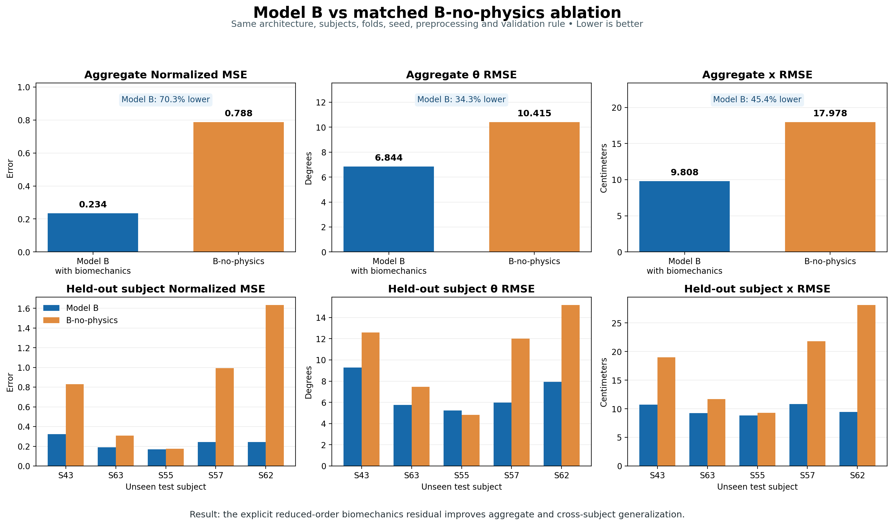

# Experiment 5 — Model B-no-physics

## Purpose

This experiment is a matched ablation of Experiment 2 / Model B. It answers:

> Does Model B improve because of the explicit reduced-order biomechanics
> residual, or because of the shared DeepONet architecture and positive
> four-coordinate controller head?

The code keeps Model B's exact neural architecture and real-data protocol. It
removes only the biomechanics residual from optimization:

```text
Model B:            L = L_real_forecast + 0.01 * L_biomechanics
Model B-no-physics: L = L_real_forecast
```

No subject-PINN teacher, teacher gain, or synthetic trajectory is used.

See `ABLATION.md` for the complete list of preserved components and the exact
scientific change.

## What remains identical to Model B

- Five subjects: S43, S63, S55, S57, and S62.
- The same five subject-held-out folds.
- The same real A11 trials and preprocessing.
- Four 0.10-second context windows from the first 0.40 seconds.
- The same five context channels: theta, forward x, theta velocity, x
  velocity, and relative time.
- The same convolutional context encoder.
- The same positive four-coordinate controller head and gain scales.
- The same branch/trunk DeepONet and Fourier-time trunk.
- The same hard initial-position and initial-velocity constraints.
- The same initial-state, demographic, auxiliary, and query-time inputs.
- The same seed, optimizer, learning rate, batch size, epoch budget, gradient
  clipping, and early stopping.
- Checkpoint selection using only the real validation subject.
- Final evaluation on the untouched real test subject.

The fixed delay and dead-zone auxiliary values remain operator inputs because
removing them would change Model B's architecture. The residual implementation
also remains in `operator_core.py` to preserve the shared source, but it is
disabled and contributes exactly zero to the objective.

## Model inputs and outputs

For each real trial:

1. The first 0.40 seconds are divided into four 0.10-second windows.
2. The context encoder reads theta, forward x, their velocities, and local
   time.
3. The controller head produces four positive coordinates through Softplus.
4. The branch receives those coordinates, the initial state, demographics,
   and fixed auxiliary values.
5. The Fourier-time trunk receives each query time.
6. The operator predicts theta and forward x for the complete time grid.
7. Training loss is calculated only on the real forecast region at or after
   0.40 seconds.

Because this experiment has neither a biomechanics residual nor gain labels,
the four positive values should be described as **positive latent controller
coordinates**, not recovered physiological gains.

## Balanced folds

| Fold | Real training subjects | Real validation subject | Real test subject |
|---:|:---|:---:|:---:|
| 1 | S55, S57, S62 | S63 | S43 |
| 2 | S43, S57, S62 | S55 | S63 |
| 3 | S43, S63, S62 | S57 | S55 |
| 4 | S43, S63, S55 | S62 | S57 |
| 5 | S63, S55, S57 | S43 | S62 |

Within every fold, validation and test subjects are excluded from gradient
training. The validation subject selects the checkpoint. The test subject is
used only once after model selection.

## Required directory placement

Place this repository beside the five existing subject directories:

```text
PINN-FallDetection-Init/
├── S43_Pole_PINN_Human_Motion/
├── S63_Pole_PINN_Human_Motion/
├── S55_Pole_PINN_Human_Motion/
├── S57_Pole_PINN_Human_Motion/
├── S62_Pole_PINN_Human_Motion/
└── Five_Subject_DeepONet_Experiment5_B_No_Physics/
```

The expected real-data files are:

```text
S*_Pole_PINN_Human_Motion/data/pole_compatible/A11/SubjectB_S*A11T*.tsv
```

No subject-specific checkpoint, gain sweep, teacher result, or synthetic
dataset is required.

## Run on your Mac

### 1. Enter the repository

```bash
cd Five_Subject_DeepONet_Experiment5_B_No_Physics
chmod +x run_on_mac.sh
```

### 2. Install or update the shared environment

```bash
./run_on_mac.sh setup
```

The runner uses `~/.venv` and selects Apple MPS first, then CUDA, then CPU. It
sets `PYTORCH_ENABLE_MPS_FALLBACK=1` automatically.

### 3. Validate the configuration and subject files

```bash
./run_on_mac.sh validate
```

This rejects subject overlap, missing trials, teacher dependencies, a latent
Model-A head, enabled physics, or any nonzero physics weight.

### 4. Run unit and syntax tests

```bash
./run_on_mac.sh test
```

The tests verify the five-fold protocol, four-window context, forward-operator
shape, retained positive controller head, and disabled physics settings.

### 5. Run the end-to-end smoke test

```bash
./run_on_mac.sh smoke
```

This prepares a short dataset and trains fold 1 for three epochs. It verifies
data preparation, MPS/CPU execution, validation checkpointing, evaluation,
plots, and metrics. It is not a scientific result.

### 6. Prepare the full real dataset

```bash
./run_on_mac.sh prepare
```

Preprocessing removes the 1,024 warm-up rows, decodes theta and forward x,
resamples from 250 Hz to 100 Hz, centers x, applies the original pre-fall
cutoff, and records a validity mask.

### 7. Optionally run one full fold

```bash
./run_on_mac.sh fold 1
```

### 8. Run all five folds and package the results

```bash
./run_on_mac.sh full
```

The command:

1. validates the setup;
2. prepares data if needed;
3. trains all five folds;
4. selects each checkpoint using real validation-subject forecast normalized
   MSE;
5. evaluates each unseen real test subject;
6. aggregates subjects with equal weight; and
7. creates the result archive.

Logs are streamed to the terminal and saved under `results/logs/`.

## Result file to return

Please send back:

```text
Five_Subject_DeepONet_Experiment5_B_No_Physics_Results.zip
```

It contains the configuration, code, provenance manifests, logs, selected
states, training histories, test predictions, per-trial metrics, fold
summaries, and the equal-subject aggregate. Prepared raw arrays are omitted.

## Planned interpretation

| Comparison | Question answered |
|:---|:---|
| B-no-physics vs B | Does the explicit biomechanics residual improve generalization when everything else is fixed? |
| A vs B-no-physics | Does Model B's positive controller head help compared with Model A's unconstrained latent head? |
| A vs B | What is the effect of the complete direct-physics formulation? |

If Model B beats B-no-physics consistently, the evidence supports a benefit
from the explicit biomechanics residual. If they are similar, Model B's earlier
advantage over A may come mainly from architecture or optimization. If
B-no-physics is better, the current residual may be over-constraining the
trajectory model.

Five subjects and one seed remain a pilot result. After this matched run, the
most important confirmation is repeating B and B-no-physics with multiple
seeds.

## Completed results

The five-fold run completed successfully on the same 20 held-out real trials
and 2,838 forecast samples used for Model B.

| Metric | Model B | B-no-physics | Model B error reduction |
|:---|---:|---:|---:|
| Normalized MSE | **0.234** | 0.788 | **70.34%** |
| Theta RMSE | **6.844 deg** | 10.415 deg | **34.29%** |
| Theta MAE | **5.162 deg** | 8.269 deg | **37.57%** |
| x RMSE | **9.808 cm** | 17.978 cm | **45.45%** |
| x MAE | **7.403 cm** | 14.302 cm | **48.24%** |
| Theta Wasserstein-1 | **3.786 deg** | 5.852 deg | **35.30%** |
| x Wasserstein-1 | **5.044 cm** | 11.005 cm | **54.17%** |

All metrics are errors, so lower is better. Model B ranked first on every
aggregate metric. It also achieved lower normalized MSE and x RMSE for every
held-out test subject. B-no-physics achieved lower theta RMSE only for S55;
Model B was better for the other four subjects.



Removing the biomechanics residual caused the largest degradation for S57 and
S62. It also allowed the positive controller coordinates to become very large
and variable because no residual or gain labels tied them to the delayed
balance equations. These coordinates must therefore be treated as latent
values in B-no-physics, not physiological gains.

The matched conclusion is:

> With Model B's architecture, data, folds, seed, preprocessing, optimizer,
> and validation rule held fixed, the explicit reduced-order biomechanics
> residual materially improved unseen-subject trajectory prediction.

See `FINDINGS.md` for the subject-level table, trial-level win counts, training
behavior, controller-coordinate analysis, limitations, and recommended
multi-seed confirmation.

## Added comparison outputs

```text
FINDINGS.md
results/full/model_b_vs_b_no_physics_comparison.png
results/full/model_b_vs_b_no_physics_aggregate.csv
results/full/model_b_vs_b_no_physics_by_subject.csv
results/full/model_b_vs_b_no_physics_summary.json
```
